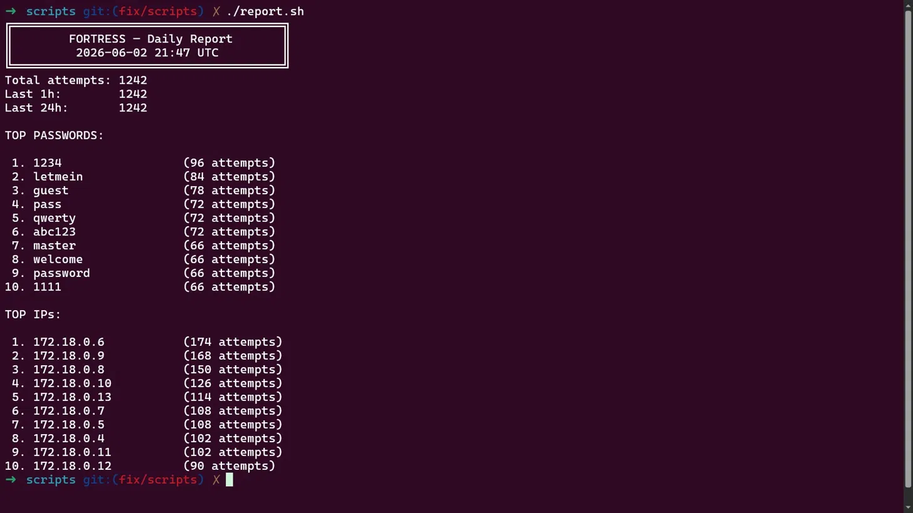
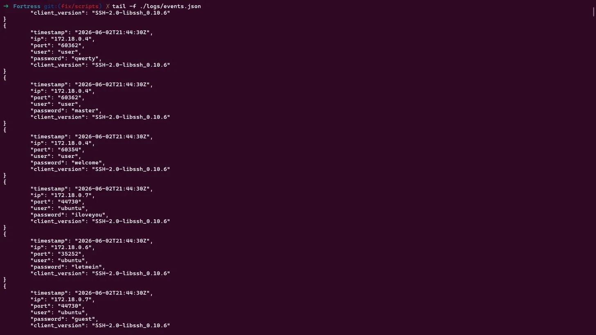

# Fortress

> Made by [1Fr3aK2](https://github.com/1Fr3aK2)
> `v2.0`


A containerized SSH honeypot written in C that captures attacker credentials in real time, aggregates brute-force patterns, detects attacks with a sliding-window analysis engine, and generates threat reports.

Built as a portfolio project to explore systems programming, network security, and container hardening.

---

## Architecture

```
┌──────────────────────────────────────────────────────────────────────────────────────┐
│  Docker project: fortress                                                            │
│                                                                                      │
│  ┌──────────────────────┐  UDP   ┌──────────────────────┐      ┌──────────────────┐  │
│  │ honeypot (C)         │ ─────▶ │ logger (C)           │      │ analyser (C++)   │  │
│  │                      │  5140  │                      │      │                  │  │
│  │ epoll loop           │        │ ingest: validate,    │      │ log parser       │  │
│  │ fork() per conn      │        │   add received_at,   │      │ attacker profile │  │
│  │ libssh trap          │        │   write events.json  │      │ sliding window   │  │
│  │ JSON logger          │        │                      │      │ detection engine │  │
│  │ event sender (UDP)   │        │ stats: hashmap +     │      │ alert writer     │  │
│  │                      │        │   min-heap → top 10  │      │                  │  │
│  └──────────────────────┘        └──────────────────────┘      └──────────────────┘  │
│          │                          │           │                       │             │
│      port 2222               events volume   logs volume         alerts volume       │
│                              (read/write)    (read/write)        (read/write)        │
│  ╔═══════════════════════════════════════════════════════════════════════════════╗    │
│  ║  Networks                                                                     ║    │
│  ║  • frontend (bridge)  →  honeypot only  →  exposes port 2222                  ║    │
│  ║  • ingest   (internal)→  honeypot ↔ logger  →  UDP event delivery             ║    │
│  ║  • analyser           →  network_mode: none  →  fully isolated                ║    │
│  ╚═══════════════════════════════════════════════════════════════════════════════╝    │
└──────────────────────────────────────────────────────────────────────────────────────┘
```

Three containers, three volumes, two networks. Each container does one job. If the honeypot is ever compromised, neither the logger nor the analyser is reachable from it — the analyser has no network at all.

---

## How It Works

**1. Connection accepted**
The honeypot opens a TCP socket on port 2222 and uses `epoll` to monitor it for incoming connections. When a connection arrives, it calls `fork()` — the child handles the SSH session, the parent goes back to waiting. Both `SIGTERM` and `SIGINT` are handled for clean shutdown via a bounded `epoll_wait`.

**2. SSH handshake**
The child process uses `libssh` (`ssh_bind`, `ssh_bind_accept_fd`) to perform a real SSH key exchange. The server presents an RSA host key generated at image build time. This is enough to fool automated tools like Hydra and Metasploit into thinking they're talking to a real SSH server.

**3. Credential capture**
After the key exchange, the honeypot waits for `SSH_REQUEST_AUTH` messages with subtype `SSH_AUTH_METHOD_PASSWORD`. Every username and password is extracted via `ssh_message_auth_user()` and `ssh_message_auth_password()`, then rejected with `ssh_message_reply_default()` to keep the attacker trying.

**4. JSON logging with field escaping**
Each authentication attempt is serialised as a JSON event. Fields are escaped and bounded — usernames are capped at 32 raw characters, passwords at 96, client versions at 64 — with proper JSON escaping (`\"`, `\\`, `\u00xx`) for control characters and non-ASCII bytes. The event is sent to the logger over UDP and never written directly to disk by the honeypot:

```json
{
	"timestamp": "2025-04-01T14:32:11Z",
	"ip": "45.33.32.156",
	"port": "54321",
	"user": "root",
	"password": "123456",
	"client_version": "SSH-2.0-libssh-0.9.3"
}
```

**5. UDP event ingestion**
The honeypot sends each event to the logger container over UDP port 5140 (via Docker DNS resolution of the `logger` hostname on the internal `ingest` network). The `event_sender` resolves the logger address every 30 seconds and retries on failure. The logger's `ingest` module validates every incoming datagram: it re-parses the full JSON structure, checks the timestamp format (`YYYY-MM-DDTHH:MM:SSZ`), validates the IP with `inet_pton`, and bounds the port to 1–65535. If validation passes, the event is re-serialised with a trusted `received_at` timestamp appended and atomically appended to `events.json`. Malformed datagrams are silently discarded with rate-limited warnings.

**6. Aggregation**
The logger reads the events file every 60 seconds. It parses each JSON object line by line using `get_next_line`, inserting passwords and IPs into two separate hashmaps. Each hashmap uses a djb2-style hash function with 256 buckets and chaining for collision resolution. To find the top 10 entries, a min-heap of size 10 is built over the hashmap — O(n log 10) — and then sorted with insertion sort. The result is written to `stats.json`.

**7. Brute-force detection (Analysis Engine)**
The analysis engine runs as a separate C++ container (`analyser`) with no network access (`network_mode: none`). It reads `events.json` from a read-only volume mount, parsing events line by line. For each source IP, it maintains an `attackerProfile` tracking all credentials, timestamps, ports, and client versions. A `slidingWindow` (backed by a `std::deque<time_t>`) counts the number of attempts within a configurable window (default: 60 seconds). The `detectionEngine` raises alerts at two thresholds:

| Threshold | Attempts in window | Severity |
|-----------|-------------------|----------|
| `BRUTE_FORCE_THRESHOLD` | ≥ 5 | Warning |
| `BRUTE_FORCE_CRITICAL_THRESHOLD` | ≥ 20 | Critical |

Each alert is emitted once per severity level per IP — duplicate alerts are suppressed. Inactive attacker profiles (no events for 300 seconds) are automatically evicted to bound memory usage. Alerts are written as JSON to `alerts.json`:

```json
{
  "timestamp": "2025-04-01T14:32:45Z",
  "ip": "45.33.32.156",
  "type": "brute_force",
  "severity": "Critical",
  "message": "22 attempts in 60 seconds",
  "count": 22
}
```

**8. Report**
`./scripts/report.sh` reads `stats.json` from the `fortress_logs` named volume (using a temporary Alpine container) and prints a formatted report to the terminal.

---

## Security Decisions

**`cap_drop: ALL` + `cap_add: NET_BIND_SERVICE`**
By default Docker containers inherit a broad set of Linux capabilities. Dropping all of them and adding back only `NET_BIND_SERVICE` means the honeypot process can bind to port 2222 and nothing else. It cannot modify network interfaces, write to arbitrary files, or escalate privileges — even if an attacker somehow breaks out of the SSH trap.

**`read_only: true`**
All three container filesystems are mounted read-only. The only writable paths are the shared volumes and `/tmp` and `/run` via `tmpfs`. This means any attempt to write to the container filesystem — drop a file, modify a binary — fails immediately.

**`tmpfs: [/tmp, /run]`**
Some processes need to write temporary files. Rather than making the whole filesystem writable, only `/tmp` and `/run` are mounted as in-memory tmpfs. Data written there never touches disk and disappears when the container stops.

**`mem_limit` and `cpus`**
Resource limits prevent a single container from consuming the host if it receives a flood of connections. Each container is capped at 256MB RAM and 0.5 CPU cores.

**Multi-stage Docker builds**
All three Dockerfiles use multi-stage builds: the build stage installs compilers and development headers, compiles the binary, and the runtime stage copies only the final binary into a minimal image. This reduces the attack surface — no compilers, no source code, no build tools exist in the running container.

**Non-root users**
Each container runs as a dedicated non-root user (`honeypot:10003`, `logger:10002`, `analyser:10001`) created at build time with `--no-create-home` and `/usr/sbin/nologin`. This limits the blast radius if a process is compromised.

**SSH host key generated at build time**
The RSA host key is generated inside the Dockerfile with `ssh-keygen`. It never exists outside the container and is never committed to the repository. Every `docker build` produces a fresh key.

**Network isolation**
The `frontend` network only exposes the honeypot. The `ingest` network is marked `internal: true` — no external routing — and connects only the honeypot to the logger for UDP event delivery. The analyser runs with `network_mode: none` — it has zero network access and reads events from a read-only volume.

**Named volumes over bind mounts**
Logs are stored in Docker named volumes (`events`, `logs`, `alerts`) instead of bind mounts. This prevents the container from accessing or modifying the host filesystem.

**Honeypot writes nothing to disk**
The honeypot no longer writes `events.json` directly. Events are sent over UDP to the logger, which validates and writes them. This means even if the honeypot is fully compromised, the attacker cannot corrupt the log file.

**Input validation at the ingestion boundary**
The logger validates every field of every incoming UDP datagram before writing it to disk: timestamp format, IP address (`inet_pton`), port range, JSON structure, and field length limits. The event is re-serialised from validated fields, so no raw attacker data reaches the log file unvalidated.

---

## What I Built

| Component        | Language | Key concepts                                                      |
|------------------|----------|-------------------------------------------------------------------|
| Honeypot         | C        | `epoll`, `fork`, `libssh`, JSON serialisation, field escaping     |
| Event Sender     | C        | UDP socket, DNS resolution, `sendto`, retry with backoff          |
| Logger / Ingest  | C        | UDP listener, `select` loop, input validation, `inet_pton`       |
| Logger / Stats   | C        | Hashmap, min-heap, `get_next_line`, file I/O                     |
| Analysis Engine  | C++20    | Sliding window, attacker profiling, brute-force detection, alerts |
| Report           | Bash     | `sed`, `grep`, Docker volume reads, formatted terminal output    |
| Infrastructure   | Docker   | Multi-stage builds, multi-container compose, network isolation    |

---

## What I Learned

C is my primary language, but this project pushed it into territory I hadn't touched before. The hardest part was working with `libssh` — the documentation is sparse and understanding the flow of `ssh_bind_accept_fd` → `ssh_handle_key_exchange` → `ssh_message_get` took real trial and error. Getting `epoll` right alongside `fork()` also required careful thought: the child process needs to close the epoll fd and the listening socket before doing anything else, otherwise file descriptor leaks cause subtle bugs that only appear under load.

Building the hashmap and min-heap from scratch in C for the logger was a deliberate choice. I wanted to understand the data structures rather than reach for a library. The heap gives O(n log 10) to find the top 10 entries over an arbitrarily large dataset — constant space regardless of how many events accumulate.

Docker hardening was new to me. I knew `cap_drop` existed but understanding *which* capabilities to drop and *why* — and then adding `tmpfs` to handle the edge cases that `read_only` introduces — made the security model concrete rather than theoretical.

The UDP ingestion pipeline taught me how to build a trust boundary inside a system. The honeypot sits in the untrusted zone — exposed to the internet — and the logger acts as a gatekeeper. Every datagram is validated field by field before anything touches disk. Adding the `received_at` timestamp on the logger side means even a compromised honeypot cannot forge the receive time.

Writing the analysis engine in C++ was a deliberate step up. The sliding window with a deque, per-IP attacker profiles, and a two-tier alert system (Warning at 5 attempts, Critical at 20) pushed me to think about real-time detection patterns — when to alert, when to suppress duplicates, and when to evict stale state to bound memory.

Multi-stage Docker builds and non-root users forced me to think about what actually needs to be in a production image. Stripping compilers, headers, and source code from the final image isn't just good practice — it removes tools an attacker could use if they somehow broke in.

---

## Future Work

- **Manual SSH protocol parsing** — replace `libssh` with a hand-rolled SSH handshake using OpenSSL directly, eliminating the external dependency and demonstrating deep protocol knowledge at the packet level
- **Thread pool** — replace `fork()` per connection with a fixed-size thread pool for better resource efficiency under high concurrency, removing the overhead of process creation per session
- **HTTP and FTP honeypots** — extend to additional services with fake admin panels and login pages to capture a broader attacker profile and detect web-based scanners
- **Real-time dashboard** — a fourth container serving live threat visualisations via Server-Sent Events over a C++ HTTP server, built on top of the existing Webserv foundation
- **GeoIP resolution** — resolve attacker IPs to country using `libmaxminddb`, include in `stats.json` and the terminal report
- **Username tracking** — extend hashmap aggregation to cover usernames alongside passwords and IPs for a complete credential picture

---

## Running

```bash
git clone https://github.com/1Fr3aK2/Fortress
cd Fortress
make
```

`make` builds all three images, cleans the host key from `known_hosts` to avoid false warnings, and starts all containers in the background.

```bash
# Simple test
ssh -p 2222 root@localhost

# Or test with Hydra
hydra -l root -P wordlist.txt ssh://localhost:2222

# View live events (from inside the logger volume)
docker run --rm -v fortress_events:/data:ro alpine tail -f /data/events.json

# Generate a report
./scripts/report.sh

# View service logs
make logs SERVICE=honeypot
make logs SERVICE=analyser

# Stop everything
make down

# Full cleanup (remove volumes, images, and build artifacts)
make fclean
```

---

## Example Output

Live capture during a simulated brute-force attack:



Report generated after aggregation:



---

## Project Structure

```
fortress/
├── docker-compose.yml
├── Makefile
├── scripts/
│   ├── report.sh               ← reads stats.json from named volume
│   └── test_ingest.sh          ← validates UDP event ingestion pipeline
├── honeypot/
│   ├── Dockerfile              ← multi-stage build, non-root user
│   ├── Makefile
│   └── src/
│       ├── main.c              ← epoll loop, SIGTERM/SIGINT handling
│       ├── ssh_trap.c          ← libssh bind, key exchange, credential capture
│       ├── logger.c            ← JSON event writer with field escaping
│       ├── event_sender.c      ← UDP sender to logger (DNS resolve + sendto)
│       └── utils.c             ← signal handlers
├── logger/
│   ├── Dockerfile              ← multi-stage build, non-root user
│   ├── Makefile
│   └── src/
│       ├── main.c              ← select loop: UDP ingest + 60s stats cycle
│       ├── ingest.c            ← UDP listener, event validation, disk writer
│       ├── stats_writer.c      ← JSON parser, stats aggregation
│       ├── hash_map.c          ← hashmap with chaining (djb2, 256 buckets)
│       └── algorithm/
│           └── heap_sort.c     ← min-heap + insertion sort for top 10
└── analysis-engine/
    ├── Dockerfile              ← multi-stage build, non-root user
    ├── Makefile
    └── src/
        ├── main.cpp            ← 60s poll loop, SIGTERM/SIGINT handling
        ├── log_parser.cpp      ← line-by-line event parser, skip malformed
        ├── detection_engine.cpp← brute-force threshold checker
        ├── attacker_profile.cpp← per-IP profile + inactive eviction
        ├── sliding_window.cpp  ← deque-based sliding window counter
        └── alert_writer.cpp    ← JSON alert serialiser (nlohmann/json)
```
